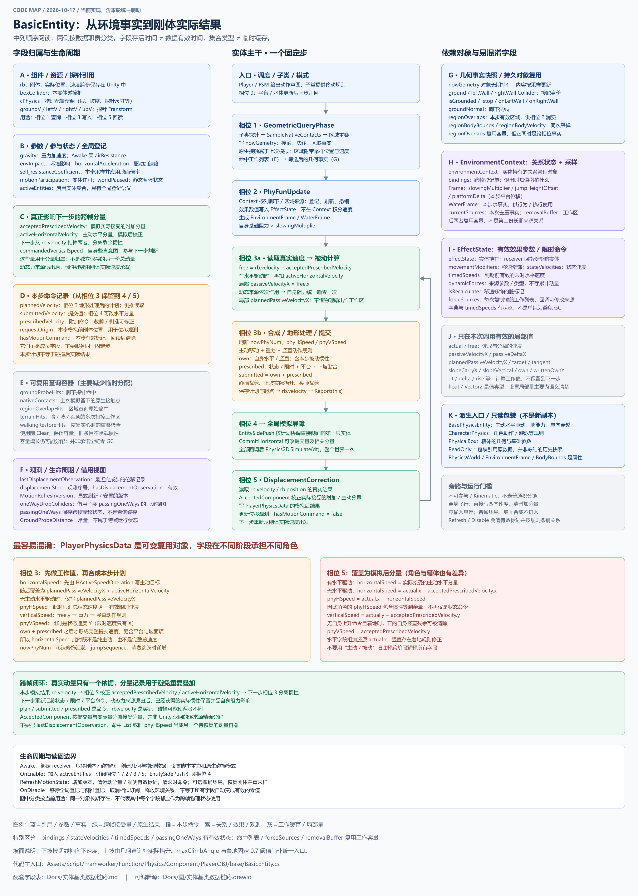

# 实体基类数据链路与字段分类

更新：2026-10-17。以当前 `BasicEntity` 为主干，包含统一制动调整后的实现。本文是现码说明；字段分类按用途，而非按类型或是否声明为成员判断。

[可编辑图源](图/实体基类数据链路.drawio)。图中间从上到下是固定步主链，两侧是字段分类，底部单列速度字段的阶段变化。

## 1. 主链：每步从真实速度出发

| 阶段 | 输入 → 处理 → 输出 |
|---|---|
| 初始化 / 启用 | `Awake` 取得组件、创建数据对象并配置刚体；`OnEnable` 订阅相位 1 / 2 / 3 / 5。子类提供角色或箱体的查询与动作规则 |
| 相位 0 | 平台与水体先更新；调度器同步几何，供后续查询 |
| 相位 1 | 探针、上次模拟留下的原生接触、当前区域重叠 → `nowGemetry`。原生命中工作列表与最终筛选事实分开保存 |
| 相位 2 | `nowGemetry` → Context 核对来源、登记或撤销效果 → EffectState 的参数容器，以及 `EnvironmentFrame / WaterFrame`。基础阻力乘地面倍率 |
| 相位 3：分离 | `rb.velocity − acceptedPrescribedVelocity`，有主动水平驱动时再减 `activeHorizontalVelocity`，得到本步被动计算起点 |
| 相位 3：计算 | 动态来源依次处理水平速度，再统一施加自身阻力；局部量承载结果。汇总状态 / 限时速度，消费主动水平、重力和竖直动作规则 |
| 相位 3：提交 | 自身速度 + 状态 / 限时速度 + 平台携带 + 下坡贴合 → 静墙、上坡与头顶处理 → 保存计划、写刚体速度、登记侧推 |
| 相位 4 | 侧推读取计划，按需要通过 `CommitHorizontal` 调整双方提交速度及相关分量；目前协调直接侧面的第一只实体 |
| 模拟屏障 | 相位 4 回调结束后，整个 Unity 2D 世界统一模拟一次 |
| 相位 5 | 读实际位置 / 速度 → 校正接受分量、更新物理输出与位移观测 → 下一步重新从刚体出发 |

普通链的运行门槛包括参与许可、启用状态与刚体类型。穿墙飞行另走相位 3 的简短分支：直接写四向速度，清附加分量，跳过普通环境与地形合成，再参加同一次公共模拟。

## 2. 组件、资源与配置引用

| 字段 / 属性 | 职责与生命周期 |
|---|---|
| `rb` | `Rigidbody2D` 引用。**跨步实际动量与位置的依据在刚体上**，此字段自身只是组件引用 |
| `boxCollider` | 本实体碰撞框引用，供几何查询、过滤与碰撞参与使用 |
| `cPhysics` | `SO_CPhysics` 资源引用：查询尺寸、层、最大爬坡角度等配置 |
| `groundV / leftV / rightV / upV` | Inspector 配置的探针 Transform 引用；查询时换算到刚体物理位置，避免显示插值带动探针 |
| `gravity / airResistance` | 重力参数；`Awake` 执行 `gravity *= airResistance`。`airResistance` 在这里不是每步水平制动量 |
| `envImpact` | 环境效果影响系数，供受力与限时命令等使用，不等同于 Unity 的质量字段 |
| `horizontalAcceleration` | 主动水平分量每秒可改变的速度，另受本步地面倍率影响 |
| `self_resistanceCoefficient` | 本步查询得到基础值，相位 2 乘地面倍率，相位 3 用于自身制动；不是累计阻力状态 |
| `GroundProbeDistance` | 查询距离常量 |

`PhysicsWorld`、`EnvironmentFrame`、`BodyBounds` 是计算 / 转发属性，不是分别保存一份结果的字段。`HasHorizontalDrive`、`UsesWorldAxisMovement`、`UsesCollisionFreeMovement`、`CollisionFreeVelocity`、`MotionExecutionReady`、`MotionUpdatesEnabled`、`ParticipatesInWorldPause` 是可由子类提供的策略入口。

## 3. 跨帧状态、本步命令与观测

| 分类 | 字段 | 写入与使用 |
|---|---|---|
| 跨帧分量 | `acceptedPrescribedVelocity` | 相位 5 根据实际 / 提交速度分摊接受量；下一步相位 3 从实际速度扣除，避免重新叠加同一附加命令 |
| 跨帧分量 | `activeHorizontalVelocity` | 相位 3 趋近主动目标；地形、侧推与模拟回读可校正。下一步分离主动分量；解除驱动归属时清零，让实际速度交回惯性 |
| 本步及下一步判断 | `commandedVerticalSpeed` | 相位 3 记录自身竖直意图，地形裁剪后只向更低值修正；用于上坡是否补抬升、模拟后及下一步着地正 Y 残余处理。不是总速度缓存 |
| 本步命令 | `plannedVelocity` | 相位 3 静态地形处理后的计划，供侧推读取；相位 4 改提交值时，不同步覆盖这份计划 |
| 本步命令 | `submittedVelocity` | 本步待模拟的提交速度；静态地形与侧推均可调整。相位 5 用于与实际结果比较 |
| 本步命令 | `prescribedVelocity` | 状态 / 限时、平台与坡面附加命令；地形处理与侧推可调整。相位 5 据此估算实际接受的部分 |
| 本步记录 | `requestOrigin` | 相位 3 保存模拟前刚体位置，相位 5 生成位移观测 |
| 本步有效标记 | `hasMotionCommand` | 提交后为真；相位 4 / 5 据此判断是否处理，回读或停用后清除 |
| 最近完成步的观测 | `lastDisplacementObservation / displacementStep / hasDisplacementObservation` | 保存最近完成步记录、序号和有效性；查询原生接触也会检查是否已有有效模拟记录。不是待执行位移 |
| 生命周期版本 | `MotionRefreshVersion` | 显式刷新 / 安置时递增，供表现丢弃旧位置边沿 |
| 参与状态 | `motionParticipation / worldPaused` | 实体自身许可与静态世界暂停状态；影响原生参与，不直接表示速度 |
| 全局登记 | `activeEntities` | 静态启用实体集合，启用 / 停用时维护；暂停同步、恢复实心补查会读取。它是有效登记，不是单纯查询缓存 |

`AcceptedComponent` 是依据总提交量与实际量进行分摊的框架估算，并非 Unity 提供的逐来源精确分解。`rb.velocity` 才是本步模拟后的实际总速度。

## 4. 主要用于减少临时分配的工作容器

以下列表的**对象与容量**长期保留，条目在每次对应查询前清除并重新填充；不用于保存跨帧惯性。容量增长仍可能分配，不能因此宣称整条链零 GC。

| 容器 | 用途 |
|---|---|
| `groundProbeHits` | 脚下扫掠命中，再筛选支撑面 |
| `nativeContacts` | 读取上次 Unity 模拟留下的原生接触点 |
| `regionOverlapHits` | 当前区域查询原始命中，再筛选写入几何事实 |
| `terrainHits` | 墙、坡面、头顶等多次地形扫掠共用工作区 |
| `walkingRestoreHits` | 从穿墙恢复实心时，查询当前位置是否有深重叠 |

以下几项需要特别区分：

| 容器 / 视图 | 实际归属 |
|---|---|
| `nowGemetry.regionOverlaps` | 复用容量的**本步事实列表**，由相位 1 写，供相位 2 消费；与原始命中工作区不同 |
| `oneWayDropColliders` | 借用子类 `passingOneWays` 的只读列表视图，不拥有另一份列表 |
| 子类 `passingOneWays` | 跨帧记录尚未穿完的单向平台，需要维护碰撞忽略关系，**不是临时命中缓存** |
| 子类 `oneWayDropHits` | 单向平台查询工作列表，复用容量 |

## 5. 持久对象内部：哪些是事实，哪些是有效状态

| 持有对象 | 内部数据的职责 |
|---|---|
| `nowGemetry` | 几何事实对象。接触 Collider、着地 / 顶头 / 左右墙标记、`groundNormal` 按采样更新；`regionBodyBounds / regionBodyVelocity` 与区域查询同次采样，避免相位间混用位置和速度 |
| `environmentContext` | 关系对象。`bindings` 跨帧记录来源及退出时的撤销凭据；不积分动量。`Frame / WaterFrame` 是最近一次采样结果 |
| Context 的 `currentSources / removalBuffer` | 本次来源核对的去重集合、移除工作列表；复用容量，不是第二套长期绑定 |
| `effectState` | 效果参数对象。`movementModifiers / stateVelocities / dynamicForces` 保存仍有效的来源参数；`timedSpeeds` 保存未到期命令，均有状态语义。`dynamicForces` 不存旧式逐来源累计速度 |
| EffectState 的 `receiver / isRecalculate` | 受影响实体引用、移速修饰重算的脏标记 |
| EffectState 的 `forceSources` | 每次受力计算复制当前来源键，便于来源回调修改登记；兼具复用容量用途，不是来源的长期权威记录 |
| `playerPhysicsData` | 可变计算 / 输出对象，字段存在阶段复用，详见下表。不能将整个对象视为不可变最终结果 |

`EnvironmentFrame` 中 `slowingMultiplier` 是地面阻力倍率，`jumpHeightOffset` 是起跳加成，`platformDelta` 是平台本步位移。环境状态速度与动态力参数来自效果容器，并不都包含在这个 Frame 内。

## 6. 速度字段必须结合阶段理解

| 字段 | 相位 3 计算 / 提交前 | 相位 5 模拟后 |
|---|---|---|
| `horizontalSpeed` | 主动操作先写目标；随后覆盖为被动水平结果 + 主动水平分量。无水平驱动则仅为被动水平结果 | 有水平驱动：实际接受的主动分量；无水平驱动：`actual.x − acceptedPrescribedVelocity.x` |
| `phyHSpeed` | 状态速度 X + 有效限时水平速度 | `actual.x − horizontalSpeed`；角色时包含惯性等剩余量，箱体时不采用同一主动 / 被动划分 |
| `verticalSpeed` | 从 `free.y` 出发，依次处理重力与动作规则 | `actual.y − acceptedPrescribedVelocity.y`；无自身上升命令且着地时，可丢掉碰撞挤出的正 Y 残余 |
| `phyVSpeed` | 状态速度 Y；当前限时命令只提供 X | 实际接受的附加竖直分量 |
| `nowPhyNum` | 移速修饰来源的汇总结果，有脏标记才重算 | 保留最近计算值，不是实际速度 |
| `jumpSequence` | 真正消费跳跃 / 墙跳时递增 | 供表现识别起跳事件，不因被动顶起递增 |

局部量 `actual / free / passiveVelocityX / passiveDeltaX / plannedPassiveVelocityX / target / tangent / slopeCarryX / slopeVertical / own / writtenOwnY` 只服务本次调用。`float / Vector2` 为值类型；将工作值改用局部量，主要为了明确计算归属，而非创建新状态容器。

水平输出两字段相加可还原模拟后的 `actual.x`；竖直输出存在上述着地规则修正。角色只读包装 `ReadOnly_*` 持有原数据引用，**不是冻结的历史快照**，读取时机仍然重要。

## 7. 生命周期与核对边界

- `RefreshMotionState` 增加刷新版本，清运动分量与有效标记，清限时命令；可选释放环境关系，再恢复刚体并重采样。部分记录只标记失效，并非所有字段都逐个清零。
- `OnDisable` 移除启用登记、侧推登记与相位订阅，释放环境关系；不要继续读取已失效的命令或观测作为新结果。
- 动态力来源退出只撤销施力控制，已获得的实际惯性继续受自身阻力影响。状态 / 限时速度属于重新汇总的命令，到期或撤销后不再按原值附加。
- 下坡按当前切线补向下速度；上坡查询实际所需抬升。上坡限制使用 `maxClimbAngle`，着地筛选仍有固定 `normal.y > 0.7f`，目前并非完全统一的坡度入口。

代码入口：[BasicEntity](../Assets/Script/Framworker/Function/Physics/Component/PlayerOBJ/base/BasicEntity.cs)、[BasePhysicsEntity](../Assets/Script/Framworker/Function/Physics/Component/PlayerOBJ/base/BasePhysicsEntity.cs)、[EntityEffectState](../Assets/Script/Framworker/Function/Physics/Data/EntityEffectState.cs)、[EntityEnvironmentContext](../Assets/Script/Framworker/Function/Physics/Base/EntityEnvironmentContext.cs)、[数据结构](../Assets/Script/Framworker/Function/Physics/Data/Struct.cs)、[EntitySidePush](../Assets/Script/Framworker/Function/Physics/Base/EntitySidePush.cs)。整体时序见[当前框架](当前框架.md)。
