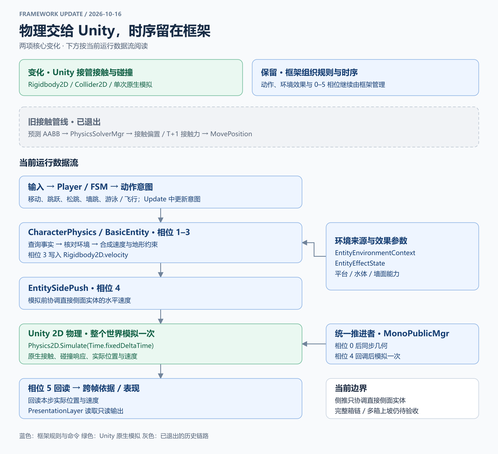
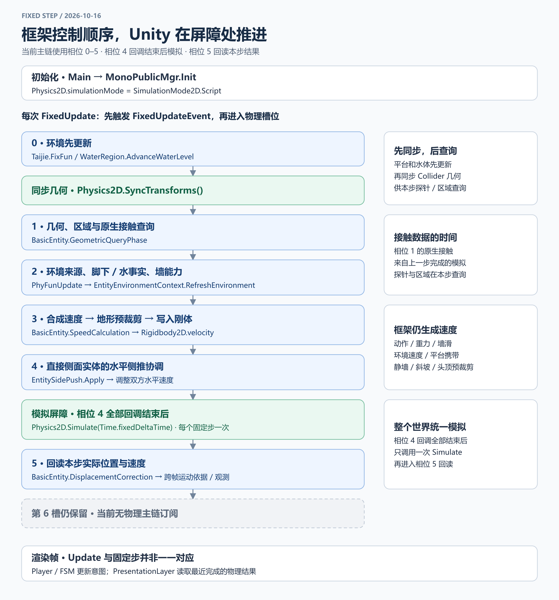

# 当前框架：Unity 物理与框架时序

更新：2026-10-16。本文和配图描述当前代码；[历史待办](历史待办.md)中的旧解算步骤不再作为实现要求。

## 一、物理交给 Unity，动作与环境规则留在框架

输入经 `Player` 和 FSM 形成动作意图，`CharacterPhysics / BasicEntity` 消费动作、环境效果与地形约束后写入刚体速度。`EntitySidePush` 在模拟前协调直接侧面实体的水平速度，Unity 随后处理真实接触与碰撞响应。模拟完成后，实体回读实际位置、速度，表现层读取只读输出。

逐字段的数据读写、生命周期与复用容器分类见[实体基类数据链路图与字段表](实体基类数据链路.md)，其中单列 `horizontalSpeed / phyHSpeed` 在计算和回读阶段的含义变化。

框架仍负责重力规则、跳跃/松跳、墙滑/墙跳、地形预裁剪、平台携带及水体/游泳规则。“改走 Unity 物理”指接触与最终运动由 Unity 模拟完成，动作速度的生成仍在框架中。

环境来源由 `EntityEnvironmentContext` 核对，效果参数由 `EntityEffectState` 管理。脚下/区域提供持续效果，墙面能力单独解析；环境参数版本变化时在正常环境相位刷新登记。水下或水面游泳模式由 `Player` 根据水事实选择。

`Player.TrySetFlying(bool)` 提供基本穿墙四向移动开关：斜向等速、零输入悬停，飞行期间屏蔽环境效果，恢复实心前检查当前位置。执行复用现有相位 3 速度写入和公共原生模拟，不增加身份、资源、关卡规则。水中关闭飞行后重新采样，自动恢复适用的游泳模式。

场景测试入口为 [PlayerFourWayTesk](../Assets/Script/Tesk/PlayerFourWayTesk.cs)，已挂在当前 `player20.prefab`：WASD 移动，F 或按钮切换飞行。人物动画直接替换为来源工程的本体切片；游泳读取对应水下/水面循环，飞行复用本体待机。

## 二、保留分阶段调度，每个固定步只模拟一次

`Main` 初始化 `MonoPublicMgr` 时设置 `Physics2D.simulationMode = SimulationMode2D.Script`。每次 `FixedUpdate` 先触发公共固定更新事件，再按槽位顺序执行：

| 顺序 | 当前职责 | 关键入口 / 结果 |
|---|---|---|
| 相位 0 | 平台运动、水位与范围更新 | `Taijie.FixFun`、`WaterRegion.AdvanceWaterLevel`；回调结束后 `Physics2D.SyncTransforms()` |
| 相位 1 | 查询几何、单向平台、区域和原生接触 | `BasicEntity.GeometricQueryPhase`；原生接触来自上一步已完成的模拟 |
| 相位 2 | 核对环境来源，采样脚下/水事实，解析墙能力 | `PhyFunUpdate` → `EntityEnvironmentContext.RefreshEnvironment` |
| 相位 3 | 读取实际速度，消费动作与效果，处理墙/坡/头顶约束 | `BasicEntity.SpeedCalculation` → 写 `Rigidbody2D.velocity` |
| 相位 4 | 按本步计划运动协调直接侧面的第一只实体 | `EntitySidePush.Apply` → 调整双方水平速度；没有自研箱链求解 |
| 模拟屏障 | 相位 4 全部回调结束后，推进整个 Unity 2D 世界一次 | `Physics2D.Simulate(Time.fixedDeltaTime)` |
| 相位 5 | 回读本步实际位置和速度，更新跨帧运动依据与观测 | `BasicEntity.DisplacementCorrection`；此处已不提交 `MovePosition` |

调度数组仍有 **7 个槽（0–6）**；当前物理主链使用 **0–5**，第 6 槽没有物理主链订阅。图中六相位指当前职责，并不表示数组已改成六槽。

`Update` 与固定步不是一一对应：FSM 在 `Player.Update` 更新意图，动作在物理步内消费；`PresentationLayer.Update` 读取最近完成的物理结果。相位 1 的原生接触属于上一步，相位 5 的位置/速度属于本步；不要把两者误标为同一次采样，也不要把计划速度当作碰撞后速度。

## 代码阅读顺序

| 顺序 / 职责 | 代码入口 |
|---|---|
| 1. 初始化、时序与模拟屏障 | [Main](../Assets/Script/Framworker/Main.cs)、[MonoPublicMgr](../Assets/Script/Framworker/AOTSystem/Mgr/Scheduling/MonoPublicMgr.cs) |
| 2. 输入、行为与运动模式 | [Player](../Assets/Script/Framworker/Function/Player/Player.cs)、[InputControlMgr](../Assets/Script/Framworker/Function/Player/Mgr/InputControlMgr.cs)、[PlayerStateMachine](../Assets/Script/Framworker/Function/Player/FSM/PlayerStateMachine.cs)、[行为状态](../Assets/Script/Framworker/Function/Player/FSM/BehavioralState.cs) |
| 3. 几何、速度写入与结果回读 | [BasicEntity](../Assets/Script/Framworker/Function/Physics/Component/PlayerOBJ/base/BasicEntity.cs)、[BasePhysicsEntity](../Assets/Script/Framworker/Function/Physics/Component/PlayerOBJ/base/BasePhysicsEntity.cs)、[CharacterPhysics](../Assets/Script/Framworker/Function/Physics/Component/PlayerOBJ/CharacterPhysics.cs)、[PhysicalBox](../Assets/Script/Framworker/Function/Physics/Component/SceneObjects/PhysicalBox.cs) |
| 4. 模拟前侧推协调 | [EntitySidePush](../Assets/Script/Framworker/Function/Physics/Base/EntitySidePush.cs) |
| 5. 环境来源与效果参数 | [EntityEnvironmentContext](../Assets/Script/Framworker/Function/Physics/Base/EntityEnvironmentContext.cs)、[EntityEffectState](../Assets/Script/Framworker/Function/Physics/Data/EntityEffectState.cs)、[能力接口](../Assets/Script/Framworker/Function/Physics/Interface/IEnvironmentCapabilities.cs) |
| 6. 场景环境、槽位与编辑工具 | [BasicPhysicalObject](../Assets/Script/Framworker/Function/Physics/Component/SceneObjects/Base/BasicPhysicalObject.cs)、[EnvironmentParameter](../Assets/Script/Framworker/Function/Physics/Data/EnvironmentParameter.cs)、[Taijie](../Assets/Script/Framworker/Function/Physics/Component/SceneObjects/Taijie.cs)、[WaterRegion](../Assets/Script/Framworker/Function/Physics/Component/SceneObjects/WaterRegion.cs)、[参数面板](../Assets/Script/Framworker/Editor/Tool/EnvironmentParameterEditor.cs) |
| 7. 只读数据与表现 | [Struct](../Assets/Script/Framworker/Function/Physics/Data/Struct.cs)、[PresentationLayer](../Assets/Script/Framworker/Function/Performance/Component/PresentationLayer.cs)、[表现说明](../Assets/Script/Framworker/Function/Performance/README.md) |
| 按需：Unity 查询与访问后端 | [IPhysicsWorldAccess2D](../Assets/Script/Framworker/Function/Physics/Interface/IPhysicsWorldAccess2D.cs)、[UnityPhysicsWorldAccess2D](../Assets/Script/Framworker/Function/Physics/Base/UnityPhysicsWorldAccess2D.cs)；统一模拟仍直接由 `MonoPublicMgr` 发起 |
| 按需：编辑器观测与回归 | [通知桥](../Assets/Script/Framworker/Function/Physics/Base/PhysicsEditorObservationBridge.cs)、[观测入口](../Assets/Script/Framworker/Editor/Tool/PhyDataTest/PhysicsEditorObservation.cs)、[环境检查](../Assets/Script/Framworker/Editor/Tool/PhyDataTest/EnvironmentIntegrationChecks.cs)、[观测检查](../Assets/Script/Framworker/Editor/Tool/PhyDataTest/PhysicsEditorObservationChecks.cs)、[场景推箱检查](../Assets/Script/Framworker/Editor/Tool/PhyDataTest/SlopePushSceneChecks.cs) |
| 按需：本次迁移的运动与切片回归 | [BasicMovementMigrationChecks](../Assets/Script/Tesk/Editor/BasicMovementMigrationChecks.cs)；菜单 `自定义工具/测试工具/验证/基础四向移动与人物动画` |

## 维护边界

- 保持输入 → 行为 → 执行 → 表现的数据方向。FSM 决定行为，执行层计算并写入运动，表现层只读。
- 几何命中与环境能力分开：无脚本表面仍能阻挡，碰到墙面不自动等于可墙滑。场景能力来源仍通过 Collider 同物体的唯一 `BasicPhysicalObject` 发现。
- 以刚体实际速度作为跨帧运动基准，环境参数和命令不得重新累计已被碰撞改变的旧运动结果。来源关系归 Context，效果参数归 EffectState。
- 运行主链每步只在相位 4 后统一模拟。相位 5 回读结果；新增功能须明确在哪个相位读写，不再沿用旧预测 AABB、接触偏置和 T+1 接触力的步骤。
- 观测保持只读，编辑器专用采样与计算由 `UNITY_EDITOR` 隔离；编译、自动回归与人工场景/手感验收分别记录。
- 当前侧推只协调直接侧面的实体；完整箱链、多箱上坡和旋转箱体能力不因接入 Unity 自动视为验收完成。

图源：[当前框架.drawio](图/当前框架.drawio)，共“当前架构”“固定步时序”两页。调整职责或相位时同步更新图源与 PNG 预览。
